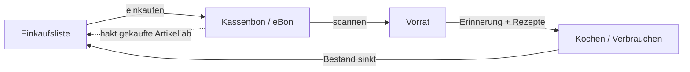
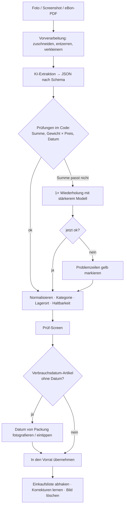
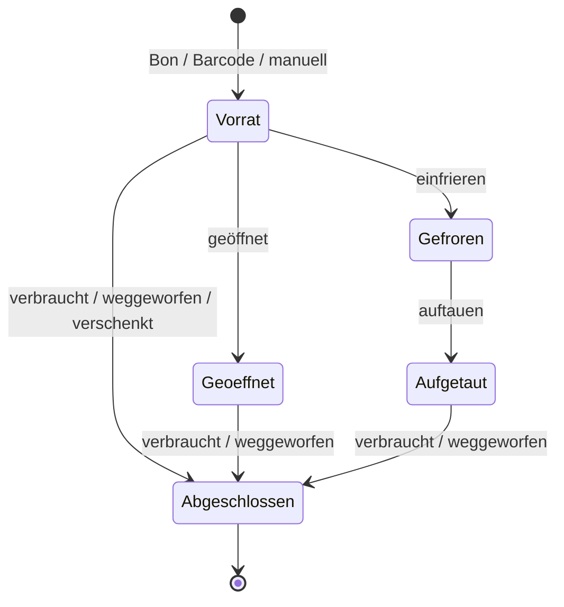
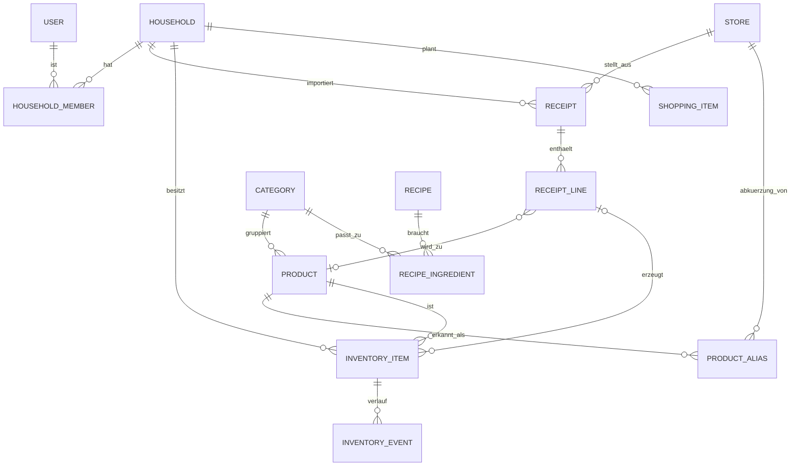
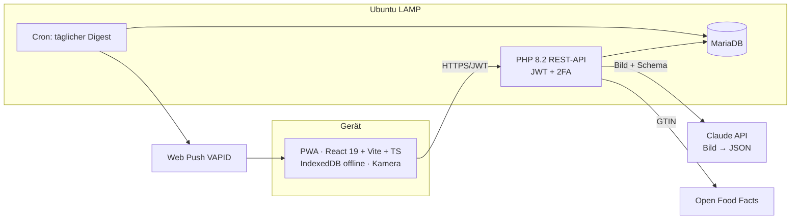

# Frischfach – Konzept: vom Kassenbon zum digitalen Vorrat

> **Arbeitstitel:** Frischfach (Markenprüfung offen – „Restlos“ ist im App Store schon vergeben)
> **Stand:** 7. November 2026 · **Status:** Konzept / vor Validierung
> **Visuelle Konzepte:** 8 klickbare Screens auf dem Design-Canvas (Link in der PR-Beschreibung)

---

## 0. Kurzfassung

- **Idee:** Nach dem Einkauf fotografierst du den Kassenbon oder machst einen Screenshot vom digitalen Bon (eBon). Die App erkennt die Lebensmittel, legt sie als **digitalen Vorrat** an und erinnert dich, bevor etwas abläuft. Dazu kommen Vorschläge, was du daraus kochen kannst, und eine Einkaufsliste, die weiß, was du schon hast.
- **Kernproblem, das wir ehrlich lösen müssen:** Auf einem Kassenbon steht **kein Haltbarkeitsdatum**. Die App muss es schätzen (Richtwerte je Kategorie), lernen oder einmal kurz von der Packung abfotografieren lassen. Bei Fleisch und Fisch mit Verbrauchsdatum wird das Packungsdatum **verlangt** und nicht geraten.
- **Warum jetzt:** Private Haushalte verursachen in Deutschland 58 % der Lebensmittelabfälle, etwa 6,3 Mio. t oder **74,5 kg pro Kopf und Jahr** (UBA, Bezugsjahr 2023). Gleichzeitig werden digitale Bons Standard: Der Kabinettsentwurf vom 23.09.2026 macht aus der Bonpflicht eine **digitale Belegbereitstellungspflicht ab 2028** (noch nicht beschlossen).
- **Technik-Empfehlung:** Ein Bild-fähiges KI-Modell liest den Bon direkt als JSON aus, danach prüft **normaler Code** (Summe stimmt? Gewicht × Preis stimmt?). Geschätzte Kosten: **unter 1 Cent pro Bon**. Stack wie AzubiBoard (React/TS-PWA, PHP 8.2, MariaDB), aber **von Anfang an mit relationalen Tabellen**.
- **Größtes Produktrisiko** ist nicht die Erkennung, sondern die **Pflege**: Wer nicht einträgt, was verbraucht ist, hat nach zwei Wochen einen falschen Vorrat. Dagegen helfen ein „Verbraucht“ mit einem Tipp, eine wöchentliche 30-Sekunden-Inventur und automatische Nachfragen („Wahrscheinlich aufgebraucht?“).

---

## 1. Begriffe und Annahmen (bitte gegenprüfen)

| Begriff | Bedeutung im Konzept |
|---|---|
| **Einkaufszettel** | Die Liste **vor** dem Einkauf (was ich kaufen will). In der App: *Einkaufsliste*. |
| **Kassenbon / Kassenzettel** | Der Beleg **nach** dem Einkauf (was ich gekauft habe). Davon ist die Rede, wenn „eingekaufte Lebensmittel verarbeitet“ werden. Ich gehe davon aus, dass du **den Kassenbon** meinst. |
| **eBon** | Digitaler Kassenbon in Händler-Apps (z. B. REWE eBon im Kundenkonto, Lidl-Plus-Bon in der App, Edeka teils als PDF per Mail). „Screenshot“ = Bildschirmfoto davon. |
| **MHD** | „Mindestens haltbar bis“: Qualitätsversprechen des Herstellers. Danach oft noch genießbar → **prüfen** (sehen, riechen, schmecken). |
| **Verbrauchsdatum** | „Zu verbrauchen bis“: für mikrobiologisch leicht verderbliche Lebensmittel (Art. 24 LMIV). Nach Ablauf gilt das Lebensmittel als **nicht sicher** → nicht mehr essen. |
| **„Verfallsdatum“** | Gibt es bei Lebensmitteln rechtlich nicht. Die Verbraucherzentrale kritisiert genau diesen Begriff an der App NoWaste. **Wir verwenden ihn nie.** |
| **Richtwert / geschätzt** | Datum, das nicht von der Packung stammt. In der App immer sichtbar als „geschätzt“ markiert. |

**Annahmen:** Privatnutzung (Einzelperson, WG, Familie) in Deutschland, deutsche Bons, Smartphone als Hauptgerät. Kein Händler-Partnerprogramm im MVP.

---

## 2. Problem und Ziele

### 2.1 Problem

1. **Vergessen:** Was hinten im Kühlschrank liegt, läuft unbemerkt ab.
2. **Unsicherheit:** MHD und Verbrauchsdatum werden verwechselt. Abgelaufenes MHD heißt nicht automatisch „wegwerfen“.
3. **Doppelt kaufen:** Im Laden weiß man nicht, ob noch Nudeln oder Eier da sind.
4. **Keine Idee:** Reste sind da, aber man weiß nicht, was man damit kochen soll.
5. **Erfassen nervt:** Bestehende Vorrats-Apps setzen auf Barcode pro Artikel und manuelle Daten. Das ist zu viel Aufwand, deshalb hören viele Nutzer damit auf.

### 2.2 Zahlen (mit Quellenlage)

| Kennzahl | Wert | Quelle / Bewertung |
|---|---|---|
| Lebensmittelabfälle gesamt (2023) | 10,9 Mio. t | UBA |
| Anteil private Haushalte | 58 % ≈ 6,3 Mio. t ≈ **74,5 kg/Kopf** | UBA. Eine andere Quelle nennt 76 kg/Kopf → **Originaltabelle von Destatis vor Veröffentlichung prüfen** |
| Wert pro Kopf und Jahr | ca. 235 € bis 372 € | **nur Hochrechnungen:** Uni Stuttgart (älter) 235 €; Too Good To Go rechnet 74,5 kg × 5 €/kg = 372,50 €. Im Marketing nur als „mehrere hundert Euro“ verwenden |

### 2.3 Ziele

| Ziel | Messbar als |
|---|---|
| Weniger wegwerfen | Wegwerfquote (weggeworfen ÷ abgeschlossene Artikel) sinkt in 8 Wochen spürbar |
| Überblick ohne Aufwand | Bon → Vorrat in **< 60 s** (Median) |
| Richtige Einschätzung | 100 % der Artikel mit Verbrauchsdatum haben ein **Packungsdatum**, nicht nur eine Schätzung |
| Weniger Doppelkäufe | „Hast du schon“-Hinweis wird bei ≥ 1 von 5 Einkäufen angezeigt (Annahme, messen) |

---

## 3. Zielgruppen und Personas

| Persona | Situation | Wichtigster Job | Konsequenz fürs Produkt |
|---|---|---|---|
| **Lena, 19, Azubi in der WG** | Knappes Budget, kauft 2×/Woche beim Discounter | „Ich will nicht schon wieder Geld wegwerfen.“ | Kostenlos nutzbar, Bilanz in €, schnelle Erfassung per Lidl-Plus-Screenshot |
| **Familie K., 2 Erw. + 2 Kinder** | Großeinkauf am Samstag, beide Eltern kaufen ein | „Wer hat was gekauft, was ist noch da?“ | Haushalt teilen, Einkaufsliste geteilt, Bon hakt Liste ab |
| **Tom, 34, Single, Vollzeit** | Kocht abends spontan, wenig Zeit | „Was koche ich heute aus dem, was da ist?“ | Tägliche Erinnerung um 17:30, Rezepte nach Dringlichkeit |

**Nicht-Zielgruppe (MVP):** Gastronomie, Kantinen, Vereine (andere Mengen, HACCP, andere rechtliche Anforderungen).

---

## 4. Markt und Wettbewerb

> Funktionen laut Recherche (Store-Seiten, Tests, Presse). **Nicht selbst getestet.**

| Angebot | Erfassung | Haltbarkeit | Rezepte | Bewertung |
|---|---|---|---|---|
| **Kitche** (UK) | Bon-Scan, Online-Bons, Barcode, Sprache | Warnung vor Ablauf | ja, nach Vorrat | Sehr nah an unserer Idee, aber UK-Markt. Laut The Grocer von **Remy übernommen** |
| **NoWaste** | Barcode, manuell | Laut Verbraucherzentrale-Test (09/2025) mussten die Haltbarkeiten **fast immer nachgebessert werden**. Nutzt den Begriff „Verfallsdatum“ | – | Zeigt, dass die Haltbarkeitsschätzung das eigentlich schwierige Problem ist |
| **Restlos** (iOS) | manuell | Erinnerungen | Rezepte als In-App-Kauf | Kostenlos nur 10 Artikel. Name vergeben |
| **„Zu gut für die Tonne!“** (BMEL) | Zutaten manuell eingeben | Lagertipps | Resterezepte, Planer/Einkaufsliste | Staatlich, kostenlos, gute Rezepte. **Kein echter Vorrat**, kein Bon |
| **Grocy** (Open Source) | Barcode, manuell | MHD-Tracking, Warnungen | Rezepte | Sehr mächtig, aber selbst gehostet und komplex. Gutes Vorbild fürs Datenmodell |
| **Händler-Apps** (REWE, Lidl Plus …) | eBon automatisch | – | Rezepte als Marketing | Liefern die Bons, verwalten aber keinen Vorrat |
| **Too Good To Go** | – | Label „Oft länger gut“ auf Packungen | – | Kein Vorrat, aber gute Aufklärung zum MHD |

**Lücke:** Für den deutschen Markt gibt es keine App, die **Bon/eBon → Vorrat** mit **ehrlicher Haltbarkeit** (MHD ≠ Verbrauchsdatum, „geschätzt“ sichtbar), **Rezepten nach Dringlichkeit** und **geteiltem Haushalt** verbindet.

**Unser Alleinstellungsmerkmal in einem Satz:** *„Bon fotografieren, fertig – Frischfach weiß, was du hast, was zuerst weg muss und was du daraus kochst.“*

---

## 5. Funktionsumfang

### 5.1 Der Kreislauf (Produktkern)



Das ist der Unterschied zu reinen Listen- oder Rezept-Apps: **Jeder Schritt füttert den nächsten.**

### 5.2 Erfassung

| Weg | Wann | MVP? |
|---|---|---|
| **Foto vom Papierbon** | Standardfall. Lange Bons in mehreren Teilen („+ Teil 2 anhängen“) | ✅ |
| **Screenshot / Bild aus Galerie** | eBon in Händler-App | ✅ |
| **eBon-PDF** | REWE/Edeka liefern PDFs (Kundenkonto/Mail). Text ist im PDF oft direkt lesbar → genauer als ein Foto | v1.0 |
| **Teilen an die App** (Share Target) | Aus Händler-App direkt „Teilen → Frischfach“. Web Share Target geht in Chromium/Android, **nicht in iOS-Safari** (Stand meines Wissens, prüfen) → für iOS braucht es eine native Hülle | v1.0 |
| **Barcode** | Einzelartikel ohne Bon (Geschenk, Vorrat von Eltern). Produktdaten über Open Food Facts | v0.2 |
| **Packungsdatum fotografieren** | Datum per Texterkennung von der Packung lesen. Pflicht bei Verbrauchsdatum | v0.2 (im MVP: manuell eintippen) |
| **Manuell / Sprache** | Fallback | manuell ✅, Sprache später |

### 5.3 Bon-Erkennung (Details in Kapitel 7)

Ergebnis: eine Liste mit Artikeln. Jeder Artikel hat **Originalzeile**, normalisierten Namen, Menge, Preis, Kategorie, Lagerort und Haltbarkeit (+ Quelle der Haltbarkeit). Danach kommt ein **Prüf-Screen** (siehe Mockup „1b“), auf dem man mit einem Tipp korrigiert. **Korrekturen werden gelernt** (Alias-Tabelle pro Händler).

### 5.4 Haltbarkeits-Engine (Herzstück)

**Grundsatz:** Lieber ehrlich „geschätzt“ als falsch genau.

**Prioritäten der Datenquelle** (höchste zuerst):

| Prio | Quelle | Sicherheit | Anzeige |
|---|---|---|---|
| 1 | Datum von der Packung (Foto/Eingabe) | hoch | „Packung“ |
| 2 | GS1-2D-Code mit Ablaufdatum (Application Identifier 17), sobald verbreitet | hoch | „Packung“ |
| 3 | Gelernter Wert für genau dieses Produkt im Haushalt (aus früheren Korrekturen) | mittel | „geschätzt (gelernt)“ |
| 4 | Richtwert der Kategorie (Startwerte aus FoodKeeper/BZfE/VZ, siehe 8) | niedrig | „geschätzt“ / „Richtwert“ |

**Regeln:**

- **Verbrauchsdatum-Kategorien** (z. B. Hackfleisch, rohes Geflügel, frischer Fisch): Ein **Packungsdatum ist Pflicht**. Ohne Datum ist der Artikel im Prüf-Screen rot markiert („Verbrauchsdatum nötig“). Wir raten hier nie.
- **Geöffnet:** `ablauf_effektiv = min(ablauf, geöffnet_am + öffnungs_richtwert)`. Grund: Das MHD gilt nur für die **ungeöffnete** Packung.
- **Eingefroren:** Das Datum ruht. Neuer Richtwert = eingefroren_am + Gefrier-Richtwert der Kategorie. Nach dem Auftauen gilt „zeitnah verbrauchen“ (Richtwert der Kategorie).
- **Lose Ware** (Obst, Gemüse, Brot vom Bäcker) hat meist **gar kein Datum** → immer ein Richtwert und eine Erinnerung zum Prüfen.

**Status-Stufen** (Farbe **immer** mit Icon + Text, nie nur die Farbe):

| Status | Bedingung | Farbe | Text in der App |
|---|---|---|---|
| Frisch | > 3 Tage | Grün | „noch 7 Tage“ |
| Bald | 2–3 Tage | Braun/Amber | „noch 3 Tage“ |
| Dringend | heute/morgen | Orange | „morgen“ |
| MHD vorbei | MHD < heute | **Blau** (nicht Rot!) | „MHD seit 2 Tagen – prüfen“ |
| Verbrauchsdatum heute / vorbei | VD ≤ heute | Rot | „heute“ / „nicht mehr essen“ |

> Warum Blau statt Rot beim MHD? Rot heißt „Gefahr, wegwerfen“. Genau dieser Fehlschluss ist ein Grund für Lebensmittelverschwendung. Blau heißt „schau es dir an“.

### 5.5 Vorrat

- Lagerorte: **Kühlschrank, Gefrierfach, Vorratsschrank** (+ eigene, z. B. „Keller“).
- Mengen: Stück, g/kg, ml/l, Packung, **„teilweise“** (Schieberegler ¼/½/¾ statt exakter Gramm).
- Aktionen pro Artikel: **Verbraucht** (1 Tipp), Teilweise, Geöffnet, Einfrieren, Auftauen, **Weggeworfen** (+ optionaler Grund: verdorben/vergessen/zu viel gekauft/schmeckt nicht), Verschenkt.
- **„Wahrscheinlich aufgebraucht?“:** Die App lernt, wie lange du ein Produkt typischerweise hast (z. B. Milch ≈ 4 Tage). Liegt ein Artikel deutlich länger ohne Abschluss im Vorrat, fragt sie in der Wochen-Inventur nach.
- **Wochen-Inventur (30 Sekunden):** Karten wischen: rechts = noch da, links = weg, oben = weggeworfen.

### 5.6 Benachrichtigungen

- **Standard: eine Zusammenfassung pro Tag** zu einer frei wählbaren Uhrzeit (Vorschlag 17:30, „vor dem Kochen“). Keine Push-Flut pro Artikel.
- **Zusätzlich nur bei Verbrauchsdatum:** Hinweis am Vortag („Hähnchen morgen fällig – einfrieren oder kochen?“).
- Ruhezeiten, komplett abschaltbar. Inhalt immer mit einer **Aktion** (Rezept öffnen, einfrieren).

### 5.7 Rezepte „Was koche ich?“

**Bewertung (deterministisch, kein KI-Modell nötig):**

```
dringlichkeit(z) = 1,0 (VD heute) | 0,8 (≤ 1 Tag) | 0,5 (≤ 3 Tage) | 0,1 (sonst)
abdeckung(r)     = vorhandene Pflichtzutaten / Pflichtzutaten   (Basics zählen als vorhanden)
score(r)         = 2 · Σ dringlichkeit(vorhandene Zutaten) + abdeckung(r) − 0,5 · fehlende Zutaten
Anzeige, wenn abdeckung ≥ 0,7 – sortiert nach score
```

- **Basics** („immer da“): Salz, Pfeffer, Öl, Mehl, Zucker … vom Nutzer einstellbar.
- **Quellen:**
  1. **Eigene, geprüfte Rezeptsammlung** (Start: 50–100 alltagstaugliche Rezepte mit strukturierten Zutaten).
  2. **KI-Vorschlag** nur, wenn die Sammlung nichts Gutes findet. **Klar gekennzeichnet** („KI-Vorschlag – Mengen/Garzeiten selbst prüfen“). Bei Geflügel/Hack immer mit Hinweis auf vollständiges Durchgaren.
  3. **Link nach außen** („im Web suchen“ mit den dringenden Zutaten als Suchbegriff). **Kein Scraping** fremder Rezeptseiten: Chefkoch hat keine offizielle API, und Scraping ist rechtlich heikel.
- Fehlende Zutat → **„+ Auf die Liste“**.

### 5.8 Einkaufsliste

- Manuell + **Vorschläge mit Begründung**:
  - **Grundbestand** unterschritten („Milch: Grundbestand 2, im Vorrat 1“).
  - **Verbrauchsrhythmus** („Eier reichen bei deinem Verbrauch noch ca. 2 Tage“).
  - **Rezept** braucht etwas.
- **„Hast du schon“-Warnung** beim Hinzufügen (Spaghetti: 2 Packungen im Schrank).
- **Bon hakt Liste ab:** Nach dem Scan werden gekaufte Artikel automatisch abgehakt. Damit schließt sich der Kreislauf.
- Geteilt im Haushalt, Änderungen live.

### 5.9 Haushalt teilen

- Ein Haushalt, mehrere Mitglieder (Einladung per Link/QR). Rollen: Besitzer, Mitglied.
- Gleichzeitige Änderungen: **Versionsnummer pro Artikel** + Konflikterkennung (Muster aus AzubiBoard `dataService` übernehmen, aber auf Zeilenebene statt auf einem JSON-Blob).

### 5.10 Bilanz / Statistik

- Pro Monat: rechtzeitig verbraucht vs. weggeworfen (Anzahl, ca. €), Quote, Verlauf.
- „Am häufigsten weggeworfen“ + **ein** konkreter Tipp (z. B. Brot in Scheiben einfrieren).
- **Haushaltsbuch light:** Die Preise stehen ja schon auf dem Bon → Ausgaben nach Kategorie. Das bringt **ohne Zusatzaufwand** einen Zusatznutzen und motiviert, die App weiter zu nutzen.

---

## 6. User Flows

### 6.1 Bon importieren



### 6.2 Lebenszyklus eines Artikels



### 6.3 Täglicher Ablauf (Persona Tom)

1. 17:30 Push: „Heute: Hähnchen (Verbrauchsdatum), Spinat (morgen). Vorschlag: Hähnchen-Spinat-Pfanne.“
2. Tipp → Rezept → kochen → „Zutaten als verbraucht markieren?“ → **ein Tipp** bucht alle Zutaten ab.
3. Fehlt etwas fürs nächste Mal → „+ Auf die Liste“.

---

## 7. Bon-Erkennung – technisches Konzept

### 7.1 Besonderheiten deutscher Kassenbons

| Merkmal | Beispiel | Umgang |
|---|---|---|
| Abgekürzte Namen (händlerspezifisch) | `HAEH.BRUSTFIL.400G`, `BIO VOLLM.3,8% 1L` | KI normalisiert. **Alias-Tabelle pro Händler** lernt aus Korrekturen |
| Gewichtsartikel (2. Zeile) | `0,412 kg x 3,99 EUR/kg` | Menge = 412 g. Prüfen: 0,412 × 3,99 = 1,64 € |
| Mengenzeile | `2 x 0,89` | Menge 2 |
| Pfand / Leergut | `PFAND 0,25`, Leergutbon negativ | Nicht in den Vorrat (Einweg 0,25 €, Mehrweg 0,08/0,15 €) |
| Rabatte / App-Coupons | `Preisvorteil -0,50` | Negative Zeile dem Artikel davor zuordnen |
| Steuerkennzeichen | `A` / `B` | Zuordnung zum Satz **je Händler unterschiedlich**. Nur **schwaches** Signal für Lebensmittel: Wasser und Säfte haben 19 %, Milch 7 % |
| Non-Food | Spülmittel, Tragetasche | Herausfiltern (optional „Haushalt“ für die Einkaufsliste) |
| Kopf/Fuß | Händler, Filiale, Datum/Uhrzeit, TSE-Transaktionsnummer | TSE-Nr. + Datum + Summe = **Fingerabdruck gegen Doppel-Import** |
| Zahlungsblock | maskierte Kartennummer, Terminal-ID | **Wird nie extrahiert** (das Schema hat dafür kein Feld) |
| Thermopapier verblasst | – | Hinweis: „Bon am besten am Einkaufstag scannen“ |

### 7.2 Optionen im Vergleich

| | A: OCR + Regeln | B: Vision-KI → JSON | C: Hybrid |
|---|---|---|---|
| Ablauf | Tesseract.js / ML Kit liest Text, eigene Regex-Parser pro Händler | Bild + JSON-Schema an ein Bild-fähiges Sprachmodell | OCR-Text **und** Bild an das Modell |
| Genauigkeit Struktur | schwach bei Zuordnung Zeile ↔ Preis, Rabatten, Gewichtszeilen | gut bei Struktur und Abkürzungen (laut Praxisberichten, **selbst messen**) | am robustesten |
| Offline / Datenschutz | ✅ alles auf dem Gerät | ❌ Bild geht an einen Dienst | ❌ |
| Aufwand | hoch (Parser pro Händler pflegen) | niedrig | mittel |
| Kosten | 0 | < 1 Cent/Bon (siehe 7.4) | ähnlich B |

**Empfehlung:** **B für das MVP**, C nur, wenn die Messung in Phase 0 bei Fotos schlechte Werte zeigt. A bleibt als späterer **Offline-/Datenschutz-Modus** (AzubiBoard hat schon Tesseract.js-Erfahrung inkl. CSP-Einstellungen).

> Eine Einordnung zur Quellenlage: Einen unabhängigen, wissenschaftlichen Vergleich speziell für deutsche Kassenbons habe ich nicht gefunden. Die verfügbaren Vergleiche stammen von Anbietern oder aus Praxisberichten, und sie widersprechen sich teilweise. **Darum ist Phase 0 (eigene Messung mit 30 echten Bons) Pflicht.**

### 7.3 Pipeline

1. **Vorverarbeitung (Gerät):** Kanten erkennen, perspektivisch entzerren, Graustufen, auf max. ~2000 px lange Kante verkleinern. Mehrere Teilfotos werden nacheinander geschickt. Screenshots und PDFs gehen ohne diesen Schritt weiter.
2. **Extraktion (Server):** Die PHP-API schickt das Bild an das Modell, mit **Structured Output** nach `bon-extraktion.schema.json`. Der API-Schlüssel liegt **nur auf dem Server**.
3. **Prüfungen im Code** (kein KI-Modell, Regel 5 aus `CLAUDE.md`):
   - Σ Positionen (inkl. Rabatte/Pfand) = Bon-Summe (±1 Cent)
   - Gewicht × Kilopreis = Zeilenpreis (±1 Cent)
   - Datum plausibel (nicht in der Zukunft, nicht älter als 30 Tage → nachfragen)
   - Fingerabdruck schon vorhanden → „Diesen Bon hast du schon importiert“
4. **Eskalation:** Summe passt nicht → **einmal** mit dem stärkeren Modell wiederholen. Danach markiert der Nutzer die Problemzeilen.
5. **Normalisierung + Zuordnung:** Alias-Tabelle (Händler + Rohtext) → Produkt → Kategorie. Unbekannt → Kategorie-Vorschlag des Modells, der Nutzer bestätigt.
6. **Haltbarkeit** nach 5.4.
7. **Prüf-Screen → Übernahme → Bild löschen.**

### 7.4 Kosten pro Bon (Schätzung, mit `count_tokens` nachmessen)

Annahmen: Bild ca. 1000 × 2000 px ≈ 2.550 Bild-Tokens (≈ 1 Token je 28 × 28 px), Prompt + Schema ≈ 1.500 Tokens → **≈ 4.000 Eingabe-Tokens**. Ausgabe JSON + kurzes Nachdenken ≈ **2.500 Tokens**. Preise laut Anthropic-Preisliste (Stand Okt. 2026):

| Modell | Eingabe | Ausgabe | **≈ pro Bon** | ≈ pro Nutzer/Jahr (2 Bons/Woche) |
|---|---|---|---|---|
| Claude Haiku 5.5 ($0,10 / $0,50 je Mio. Tokens) | $0,0004 | $0,00125 | **≈ 0,2 Cent** | ≈ 0,18 $ |
| Claude Sonnet 5.5 ($2 / $10 je Mio. Tokens) | $0,008 | $0,025 | **≈ 3 Cent** | ≈ 3,40 $ |

→ **Haiku als Standard, Sonnet nur zur Eskalation.** Ob Haiku die Abkürzungen gut genug liest, entscheidet die Messung in Phase 0, nicht dieses Dokument. Aufwand (`effort`) für die Extraktion niedrig ansetzen.

### 7.5 Beispiel (verkürzt)

Bon-Zeilen:

```
HAEH.BRUSTFIL.400G        4,99 B
PAPRIKA ROT               1,64 B
  0,412 kg x 3,99 EUR/kg
PFAND 0,25                0,25 A
SUMME                    17,87
```

Ausgabe (Auszug, Schema siehe `bon-extraktion.schema.json`):

```json
{
  "store": { "chain": "Markt Beispielstadt" },
  "purchased_at": "2026-11-07T17:42:00",
  "total_cents": 1787,
  "lines": [
    { "line_no": 1, "raw_text": "HAEH.BRUSTFIL.400G", "line_type": "item",
      "name_normalized": "Hähnchenbrustfilet", "quantity": 400, "unit": "g",
      "total_cents": 499, "is_food": true, "category_guess": "gefluegel_roh", "confidence": 0.93 },
    { "line_no": 2, "raw_text": "PAPRIKA ROT 0,412 kg x 3,99 EUR/kg", "line_type": "item",
      "name_normalized": "Paprika rot", "quantity": 412, "unit": "g", "unit_price_cents": 399,
      "total_cents": 164, "is_food": true, "category_guess": "gemuese_frucht", "confidence": 0.97 },
    { "line_no": 3, "raw_text": "PFAND 0,25", "line_type": "deposit",
      "name_normalized": "Pfand", "quantity": 1, "unit": "piece",
      "total_cents": 25, "is_food": false, "category_guess": null, "confidence": 0.99 }
  ]
}
```

---

## 8. Haltbarkeits-Datenbasis

### 8.1 Quellen für Startwerte

| Quelle | Lizenz / Nutzung | Bemerkung |
|---|---|---|
| **USDA FoodKeeper** (JSON/Excel auf data.gov) | Laut Katalog CC0 (gemeinfrei) → **vor Nutzung auf der aktuellen Katalogseite bestätigen** | Gute Struktur (Kühlschrank/Gefrierfach/Vorrat, geöffnet/ungeöffnet). US-Produkte → **für Deutschland übersetzen und prüfen**. USDA nennt die Werte selbst nur „Richtwerte“ |
| **Verbraucherzentrale / BZfE / „Zu gut für die Tonne“** | Inhalte urheberrechtlich geschützt → **Werte abgleichen, Texte nicht kopieren** | Deutsche Perspektive, MHD-Aufklärung |
| **Open Food Facts** (Barcode → Produkt) | Datenbank ODbL, Inhalte DbCL → **Namensnennung, Share-Alike bei geänderter Datenbank** | Für Produktname/Kategorie, **nicht** für Haltbarkeit. API braucht einen aussagekräftigen User-Agent |
| **Eigene Nutzerdaten** | eigene Daten, Aggregation nur mit Einwilligung | Lernt reale Haltbarkeit pro Produkt |

### 8.2 Kategorie-Tabelle (Struktur + belegte Beispielwerte)

> Nur Werte mit Quelle sind eingetragen. „offen“ = vor Launch aus FoodKeeper/VZ übernehmen und gegenprüfen.

| Kategorie | typische Datumsart | Lagerort | ungeöffnet | nach dem Öffnen | Quelle |
|---|---|---|---|---|---|
| Hackfleisch, rohes Geflügel, frischer Fisch (verpackt) | Verbrauchsdatum | Kühlschrank | **Packungsdatum Pflicht** | – | Art. 24 LMIV |
| Frischmilch | MHD | Kühlschrank | Packung / offen | ca. 3 Tage | Too Good To Go Ratgeber (zweite Quelle suchen) |
| Hartkäse | MHD | Kühlschrank | Packung | 3–4 Wochen | lovefood (schwach → mit FoodKeeper/VZ prüfen) |
| Fischkonserve, geöffnet + umgefüllt | – | Kühlschrank (4–5 °C) | Packung | ca. 1 Tag | BLE-Tabelle |
| Marinaden (Fisch), geöffnet | – | Kühlschrank | Packung | 1–2 Tage | BLE-Tabelle |
| Blattgemüse (lose) | kein Datum | Kühlschrank | offen | – | FoodKeeper/VZ |
| Brot (lose) | kein Datum | Brotkasten | offen | – | FoodKeeper/VZ |
| Nudeln, Reis (trocken) | MHD | Vorratsschrank | Packung | offen | FoodKeeper/VZ |
| Tiefkühlware | MHD | Gefrierfach | Packung | – | Packung |

**Wichtig für die Haftung:** Richtwerte sind **keine Sicherheitsgarantie**. Die App sagt nie „ist noch gut“, sondern „MHD vorbei – prüfen“. Beim Verbrauchsdatum heißt es klar „nicht mehr essen“.

---

## 9. Datenmodell

Vollständiger DDL-Entwurf: [`datenmodell.sql`](./datenmodell.sql) (MariaDB 10.6+, InnoDB, utf8mb4).

> **Lehre aus AzubiBoard:** Dort wurde mit einem JSON-Blob gestartet und in Sprint 12 aufwendig auf Tabellen umgebaut (L5). **Hier gleich relational starten.** Das macht Abfragen wie „alles, was in 2 Tagen abläuft“, Statistiken und Konflikte pro Artikel einfach.



**Wichtige Felder am Vorratsartikel (`inventory_items`):** `expires_on`, `date_type` (MHD/VD/keins), `date_source` (Packung/Nutzer/GS1/gelernt/Kategorie), `date_confidence`, `opened_at`, `frozen_at`, `thawed_at`, `status`, `version` (Konflikterkennung).

**Warum Events statt nur Status?** `inventory_events` liefert die Bilanz (verbraucht vs. weggeworfen), den Verbrauchsrhythmus (Vorschläge für die Einkaufsliste) und das Lernen der Haltbarkeit, alles aus einer Quelle.

---

## 10. Architektur und Tech-Stack

### 10.1 Empfehlung



| Baustein | Wahl | Begründung |
|---|---|---|
| Frontend | React 19 + Vite + TypeScript (strict), PWA | Gleicher Stack wie AzubiBoard → Wiederverwendung (Store-Pattern, Zod-Schemas, Lint/Typecheck-CI) |
| Offline | IndexedDB + Sync-Queue | Im Laden ist der Empfang oft schlecht. Einkaufsliste und Vorrat müssen offline lesbar sein |
| Backend | PHP 8.2 + MariaDB | Bekannt, läuft auf eurem Server. Auth/JWT/TOTP-Muster aus AzubiBoard übertragbar (als Kopie, nicht als Abhängigkeit) |
| KI | Claude API (Haiku 5.5, Eskalation Sonnet 5.5), Structured Outputs | Siehe 7.4. Nur vom Server aus aufrufen |
| Push | Web Push (VAPID) aus PHP-Cron | Siehe 10.2 |
| Tests | Vitest + Playwright (+ eigenes Bon-Testset als Eval) | Wie AzubiBoard. Zusätzlich: Erkennungsrate als Regressionstest |

### 10.2 Bessere Umsetzungsmöglichkeiten / Knackpunkte

1. **Benachrichtigungen in einer PWA sind der Schwachpunkt.** Eine PWA kann keine lokalen, zeitgesteuerten Benachrichtigungen planen (die „Notification Triggers“-API hat Chrome nach dem Test nicht weiterverfolgt). Lösung im MVP: **Server-Push per Cron**. Auf iOS funktioniert Web Push nur, wenn die PWA zum Home-Bildschirm hinzugefügt wurde (ab iOS 16.4). **Besser ab v1.0:** die PWA mit **Capacitor** als App verpacken. Damit gibt es lokale Benachrichtigungen (Android 12+: Berechtigung für exakte Alarme beachten; iOS: max. ca. 64 geplante Benachrichtigungen), eine native Kamera und das Teilen-Menü.
2. **Eigenes Repository.** Frischfach hat mit AzubiBoard fachlich nichts zu tun. Das Konzept liegt nur hier, weil der Arbeits-Branch vorgegeben war. **Empfehlung:** neues Repo `frischfach` anlegen und diesen Ordner dorthin umziehen.
3. **Nicht alles schätzen wollen.** Bei Verbrauchsdatum-Artikeln dauert ein Foto der Packung 3 Sekunden und ist ehrlicher als jede Schätzung. Das ist besser als ein ausgefeilteres Schätzmodell.
4. **KI nur für Urteilsfragen.** Summe, Gewicht × Preis, Status-Stufen und Rezept-Score sind normaler Code. Die KI liest nur den Bon und schlägt Kategorien vor. Das ist günstiger, testbar und vorhersehbar.

---

## 11. Datenschutz, Sicherheit, Haftung

| Thema | Risiko | Maßnahme |
|---|---|---|
| Bon-Bild | enthält Filiale, Uhrzeit, ggf. Zahlungsdaten | Bild **nach der Extraktion löschen** (Standard). Zahlungsblock wird nie extrahiert (Schema ohne Feld) |
| Bewegungsprofil | Filiale + Uhrzeit über Monate | Nur Kette speichern, Filiale optional. Uhrzeit nur intern für den Fingerabdruck |
| Sensible Rückschlüsse (Art. 9 DSGVO) | Einkäufe können auf Gesundheit (Diabetiker-, glutenfreie Produkte) oder Religion (halal/koscher) schließen lassen | **Keine Profilbildung, keine Werbung, kein Datenverkauf.** Datensparsamkeit (Art. 5), Privacy by Design (Art. 25) |
| KI-Dienstleister | Daten verlassen die EU | Vertrag zur Auftragsverarbeitung (Art. 28), Drittlandtransfer prüfen (z. B. EU-US Data Privacy Framework), Einstellung „kein Training mit Kundendaten“ prüfen. In der Datenschutzerklärung nennen |
| Betroffenenrechte | Auskunft, Löschung, Export | Export als JSON/CSV (Art. 20), Konto löschen = alles weg (Art. 17) |
| Sicherheit | Konten, API | JWT + optional 2FA, Rate-Limit, Schlüssel nur serverseitig, CSP (Muster aus AzubiBoard) |
| Haftung | „Die App hat gesagt, es ist noch gut“ | Richtwerte immer als solche kennzeichnen. Verbrauchsdatum nie schätzen. Hinweis in AGB/Onboarding. **Rechtliche Prüfung vor öffentlichem Start** (dieses Dokument ist keine Rechtsberatung) |

---

## 12. UX- und Design-Prinzipien

1. **Ein Tipp für das Häufigste:** „Verbraucht“ ist immer der größte Button.
2. **Ehrlich statt genau:** „geschätzt“ und „Richtwert“ sind sichtbar.
3. **Farbe nie allein:** Status = Farbe + Icon + Text. Kontrast ≥ 4,5:1, auch auf getönten Etiketten (im Canvas bereits so gewählt).
4. **Richtige Begriffe:** „Mindestens haltbar bis“, „Zu verbrauchen bis“, nie „Verfallsdatum“.
5. **Ruhige Benachrichtigungen:** eine Zusammenfassung am Tag statt Alarm pro Joghurt.
6. **Kein schlechtes Gewissen:** Die Bilanz zeigt zuerst, was gerettet wurde.

**Visuelle Sprache (Canvas):** helles, leicht grünliches Off-White (`#F6F7F2`), Tiefgrün als Hauptfarbe (`#1F6B4A`), Überschriften in *Bricolage Grotesque*, Text in *Inter*. Tab-Leiste: Heute · Vorrat · **Scannen** (Mitte, hervorgehoben) · Rezepte · Einkauf.

| Screen | Zweck |
|---|---|
| 1a Bon scannen | Kamera mit Bon-Erkennung, Quellen: Foto/Screenshot/eBon-PDF/Barcode, Teilfotos, Datenschutz-Hinweis |
| 1b Erkennung prüfen | Originalzeile ↔ erkannter Artikel, Summenprüfung, „Verbrauchsdatum nötig“, gefilterte Non-Food-Zeilen |
| 2a Heute | Was zuerst weg muss + Rezeptvorschlag + Kennzahlen |
| 2b Vorrat | Nach Lagerort, sortiert nach Ablauf, Frische-Balken mit Text |
| 2c Detail | Verbrauchsdatum ≠ MHD erklärt, Aktionen, Verlauf |
| 3a Was koche ich? | Rezepte nach Dringlichkeit, Herkunft gekennzeichnet (Sammlung vs. KI) |
| 3b Einkaufsliste | Vorschläge mit Grund, „Hast du schon“-Warnung, Abhaken per Bon |
| 3c Bilanz | Gerettet vs. weggeworfen, häufigste Wegwerfer + Tipp, Ausgaben laut Bons |

---

## 13. Umfang und Roadmap

### 13.1 MoSCoW fürs MVP

| Muss | Soll | Kann | Nicht jetzt |
|---|---|---|---|
| Bon-Foto + Screenshot → Prüf-Screen → Vorrat | Packungsdatum per Foto (OCR) | Sprache | Händler-Schnittstellen |
| Haltbarkeit nach 5.4 inkl. VD-Pflicht | Barcode (Open Food Facts) | Wochen-Inventur per Wischen | Preisvergleich |
| Aktionen verbraucht/weggeworfen/geöffnet/eingefroren | Rezepte (Sammlung + Score) | KI-Rezepte | Foodsharing-Übergabe |
| Täglicher Push-Digest | Haushalt teilen | Haushaltsbuch light | Smart-Home |
| Einkaufsliste + „Hast du schon“ | Bon hakt Liste ab | Bilanz | |

### 13.2 Phasen

| Phase | Inhalt | Ergebnis / Abbruchkriterium | Aufwand (grob, 1 Person) |
|---|---|---|---|
| **0 – Validierung** | 30 echte Bons sammeln (≥ 5 Händler; Foto, Screenshot, PDF), Soll-Daten erfassen, Haiku vs. Sonnet vs. Tesseract+Regeln messen. Canvas-Klickprototyp mit 5 Personen testen | **Weiter nur, wenn** ≥ 90 % der Positionen ohne Korrektur stimmen und die Summenprüfung bei ≥ 85 % der Fotos aufgeht | 1 Woche |
| **v0.1 MVP** | Auth, Haushalt (1 Person), Erfassung, Prüf-Screen, Vorrat, Haltbarkeit, Push, einfache Einkaufsliste | Eigene Nutzung 2 Wochen ohne Abbruch | 3–4 Wochen |
| **v0.2** | Rezepte (50–100), Barcode, Packungsdatum-OCR, Alias-Lernen | Rezeptvorschlag wird ≥ 2×/Woche geöffnet | 2–3 Wochen |
| **v0.3** | Haushalt teilen + Sync/Konflikte, Bilanz, Grundbestand/Rhythmus, Bon hakt Liste ab | Familie/WG testet 4 Wochen | 3 Wochen |
| **v1.0** | Capacitor-App (lokale Benachrichtigungen, Share-Sheet), eBon-PDF/Mail-Import, Export, Datenschutz-Paket | Öffentliche Beta | 3–4 Wochen |
| **später** | GS1-2D-Codes mit Ablaufdatum, digitaler Beleg nach Kassengesetz (QR an der Kasse), Foodsharing, Preisverlauf | – | – |

### 13.3 Chancen durch Gesetz und Standards (beobachten, nicht darauf bauen)

- **Kassengesetz-Entwurf (Kabinett 23.09.2026):** Registrierkassenpflicht ab 100.000 € Umsatz und **digitale Belegbereitstellung ab 2028**, z. B. per QR-Code auf dem Kassendisplay, Download-Link oder ins Kundenkonto. Kunden müssen den digitalen Beleg nicht annehmen. **Bundestag und Bundesrat müssen noch zustimmen.** **Offen:** ob ein **maschinenlesbares Standardformat** vorgeschrieben wird. Wenn ja, wäre das der Jackpot für die Erkennung (100 % genau, keine KI nötig).
- **GS1 „Sunrise 2027“:** Ziel ist, dass Kassen bis Ende 2027 2D-Codes (GS1 DataMatrix / Digital Link QR) lesen können. Diese Codes **können** das Ablaufdatum enthalten. Langfristig könnte das Datum dann auch im digitalen Bon stehen. Quellen dazu sind bisher vor allem Anbieter-Blogs → **bei GS1 Germany verifizieren**.

---

## 14. Erfolgskennzahlen

| Ebene | Kennzahl | Zielwert (Annahme, nach Phase 0 anpassen) |
|---|---|---|
| Erkennung | Positionen korrekt ohne Korrektur | ≥ 90 % (Screenshot/PDF ≥ 95 %) |
| Erkennung | Summenprüfung ok | ≥ 95 % Screenshot/PDF, ≥ 85 % Foto |
| Erkennung | Kosten pro Bon | < 0,5 Cent im Schnitt |
| Aufwand | Bon → Vorrat (Median) | < 60 s |
| Pflege | **Anteil Artikel mit Abschluss** (verbraucht/weggeworfen/verschenkt) | ≥ 70 % – **wichtigster Gesundheitswert** |
| Wirkung | Wegwerfquote | sinkt über 8 Wochen |
| Bindung | aktiv in Woche 4 | ≥ 30 % (Annahme) |

---

## 15. Risiken

| Risiko | Wahrscheinlichkeit | Auswirkung | Gegenmaßnahme |
|---|---|---|---|
| Nutzer pflegen den Verbrauch nicht → Vorrat stimmt nicht mehr | **hoch** | hoch | 1-Tipp-Aktionen, Rezept bucht Zutaten ab, „Wahrscheinlich aufgebraucht?“, Wochen-Inventur |
| Erkennung bei Fotos zu schlecht | mittel | hoch | Phase 0 messen, Hybrid C, Teilfotos, schneller Prüf-Screen |
| Falsche Haltbarkeit → gesundheitliches Risiko / Haftung | mittel | **sehr hoch** | VD nie schätzen, „prüfen“ statt „gut“, klare Hinweise, rechtliche Prüfung |
| KI-Kosten oder Preise ändern sich | niedrig | mittel | Haiku als Standard, Cache für bekannte Aliase, Offline-OCR als Plan B |
| Händler ändern Bon-Formate | mittel | niedrig | KI ist tolerant, Alias-Lernen, Regressions-Testset |
| Datenschutzvorfall | niedrig | hoch | Bilder löschen, Datensparsamkeit, Verschlüsselung, Pen-Test vor Launch |
| Gesetz zum digitalen Bon kommt anders / später | mittel | niedrig | Kein Teil des MVP, nur Chance |

---

## 16. Offene Entscheidungen (für dich)

1. **Zweck:** Privatprojekt/Lernprojekt oder später echtes Produkt (dann Markenrecherche DPMA/EUIPO, Impressum, AGB)?
2. **Plattform:** Reicht für den Anfang Android + Desktop (PWA), oder sind iOS-Nutzer wichtig (dann früher Capacitor)?
3. **Repo:** Neues Repo `frischfach` anlegen? (Ich kann selbst keine Repos erstellen.)
4. **Name:** „Frischfach“ behalten oder Alternativen sammeln?
5. **Phase 0:** Willst du 30 Bons sammeln? Dann baue ich das Mess-Skript (Testset + Auswertung).

---

## 17. Quellen

Rechtliches / Zahlen
- Art. 24 LMIV (VO (EU) 1169/2011): https://gesetze.legal/eu/vo_eu_2011_1169/24
- Verbraucherzentrale – MHD ist nicht gleich Verbrauchsdatum: https://www.verbraucherzentrale.de/mindesthaltbarkeitsdatum
- Umweltbundesamt – Lebensmittelabfälle: https://umweltbundesamt.de/themen/abfall-ressourcen/abfallwirtschaft/abfallvermeidung/lebensmittelabfaelle
- Cleanthinking (abweichend 76 kg/Kopf): https://www.cleanthinking.de/?p=1074350
- Kleeberg – Gesetzentwurf Kassenpflicht/digitale Belege ab 2028: https://www.kleeberg.de/en/2026/09/25/gesetzentwurf-zur-kassenpflicht-elektronische-kassensysteme-und-digitale-belege-ab-2028/
- Deutsche Handwerks Zeitung – „Bonpflicht bleibt, nur anders“: https://www.deutsche-handwerks-zeitung.de/bonpflicht-bleibt-nur-anders-was-der-gesetzentwurf-vorsieht-384034/
- IHK Köln – Bundesregierung beschließt Kassenpflicht: https://www.ihk.de/koeln/hauptnavigation/recht-steuern/steuern/bundesregierung-beschliesst-kassenpflicht-7183040
- NWB Experten-Blog – Digitale Kassen und digitale Belege: https://www.nwb-experten-blog.de/digitale-kassen-und-digitale-belege-bundeskabinett-will-steuerhinterziehung-eindaemmen-und-buerokratie-abbauen/
- Too Good To Go – Label „Oft länger gut“: https://www.toogoodtogo.com/de/press/label-oftlaengergut-2020

Wettbewerb
- Verbraucherzentrale – App-Test NoWaste: https://www.verbraucherzentrale.de/wissen/umwelt-haushalt/apptest-nowaste-lebensmittelliste-die-digitale-speisekammer-95921
- Verbraucherzentrale – App-Test „Zu gut für die Tonne!“: https://www.verbraucherzentrale.de/wissen/umwelt-haushalt/apptest-zu-gut-fuer-die-tonne-genussvoll-gutes-tun-95197
- The Grocer – Remy übernimmt Kitche: https://www.thegrocer.co.uk/news/new-ai-household-food-waste-reduction-app-remy-acquires-rival-kitche-to-boost-user-base/701748.article
- Buckinghamshire Council – Food-Waste-Apps (Kitche): https://buckinghamshire.gov.uk/cost-of-living/help-with-buying-or-accessing-food/toolkit-reducing-food-waste-at-home/useful-apps
- Restlos (App Store): https://apps.apple.com/de/app/restlos/id6754604227
- Grocy: https://github.com/grocy/grocy
- REWE eBon: https://www.rewe.de/service/ebon
- Utopia – Lidl Pfandbon digital: https://utopia.de/ratgeber/aenderung-beim-flaschenpfand-dieser-discounter-fuehrt-ein-neues-system-ein_839278/

Daten / Technik
- USDA FSIS FoodKeeper Data (data.gov): https://catalog.data.gov/dataset/fsis-foodkeeper-data
- Open Food Facts – Daten & Lizenz: https://world.openfoodfacts.org/data
- TEC-IT – GS1 Digital Link / Sunrise 2027: https://www.tec-it.com/en/support/knowbase/gs1-digital-link-sunrise/Default.aspx
- Notification Triggers (Explainer, eingestellt): https://github.com/beverloo/notification-triggers
- Engadget – Apple behält Home-Screen-Web-Apps in der EU: https://www.engadget.com/apple-backtracks-on-plans-to-get-rid-of-web-apps-on-iphones-in-the-eu-195232177.html
- Ionic/Capacitor Local Notifications: https://ionicframework.com/docs/native/local-notifications
- ImageToTable – OCR vs. VLM auf Kassenbons (Anbieter-Benchmark): https://imagetotable.ai/references/traditional-ocr-vs-document-parsing-vlm
- iunera – Receipt OCR mit LLMs vs. Tesseract (Praxisbericht): https://www.iunera.com/kraken/enterprise-ai/receipt-ocr-with-llms-vs-tesseract-what-actually-changed/
- Anthropic-Modellpreise: Stand Okt. 2026 laut offizieller Preisliste (vor Umsetzung erneut prüfen)

> **Hinweis zur Prüfung:** Einige Seiten (verbraucherzentrale.de, ihk.de, data.gov) konnte ich in dieser Umgebung nicht direkt öffnen. Die Angaben stammen aus Suchergebnissen mit Zitaten dieser Seiten. Vor einer Veröffentlichung bitte einmal direkt gegenlesen.
